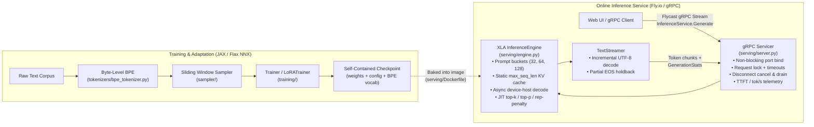

# jax-learn — Modern LLM & Streaming Inference Engine from Scratch in JAX

A decoder-only LLM stack built from first principles in **JAX / Flax NNX** — covering a custom byte-level BPE tokenizer, modern Transformer architecture (RoPE, RMSNorm, GQA, SwiGLU, MoE), LoRA fine-tuning, self-speculative decoding, and a zero-recompilation XLA gRPC streaming server deployed on Fly.io.

> **Live Demo:** [tokenizer-frontend.fly.dev](https://tokenizer-frontend.fly.dev) — backed by `tokenizer-inference` running the 15.0M-parameter TinyStories checkpoint on CPU via private Flycast gRPC with scale-to-zero suspend.

---

## System Architecture



---

## Key Engineering Highlights

### 1. Zero-Recompilation XLA Serving Engine (`serving/engine.py`)
- **Bucketed Prefill & Static KV Cache:** Prompts are right-padded to fixed buckets `(32, 64, 128)` and KV caches are preallocated to `(1, num_kv_heads, max_seq_len, head_dim)`. Because causal attention masks out padding and `jax.lax.dynamic_index_in_dim` reads logits at `prompt_len - 1`, every jitted function sees a fixed set of shapes — **zero XLA recompilation after startup warmup**.
- **Async Device-Host Pipelining:** Inside `stream_ids`, the next `_decode` call for token `i + 1` is dispatched to XLA *before* blocking on `int(token)` for token `i`, overlapping accelerator/CPU compute with Python UTF-8 decoding and gRPC frame transmission.
- **Safe Byte-Level Streaming (`TextStreamer`):** Byte-level BPE tokens can split multi-byte UTF-8 sequences across token boundaries. `TextStreamer` wraps `codecs.getincrementaldecoder('utf-8')` and holds back partial `<|endoftext|>` prefixes so stop tokens never leak to the client.
- **Device-Side Sampling (`inference/sampling.py`):** Fully JIT-compiled repetition penalty, temperature scaling, top-k truncation, and top-p (nucleus) filtering executed on device inside the prefill/decode graphs.

### 2. Production-Minded gRPC Streaming Server (`serving/server.py`, `fly.inference.toml`)
- **Server-Streaming Protocol:** Defined in [`serving/protos/inference/inference_api.proto`](serving/protos/inference/inference_api.proto) with HTTP transcoding annotations (`POST /v1/generate`), streaming text chunks followed by a terminal `GenerationStats` payload (`prompt_tokens`, `generated_tokens`, `ttft_ms`, `tokens_per_second`).
- **Fast Cold-Start Binding:** Opens port `50051` immediately and imports JAX, loads the checkpoint, and warms all prompt buckets on a background thread — keeping startup health checks green and logging load time, warmup time, and peak RSS.
- **Operational Controls:** Input validation and parameter clamping, bounded readiness/queue timeouts (`READY_TIMEOUT_S`, `QUEUE_TIMEOUT_S`), immediate abort on client disconnect (`context.is_active()`), graceful `SIGINT` drain for Fly.io idle suspension, and scale-to-zero deployment (`min_machines_running = 0`, `auto_stop_machines = "suspend"`).

### 3. Modern Transformer & Parameter-Efficient Training (`transformer/`, `lora/`, `training/`)
- **Architecture (`transformer/`):** Pre-norm decoder blocks with **RMSNorm**, **RoPE** (with dynamic `offset` support for KV-cached decoding), **Grouped-Query Attention (GQA)** via `jax.nn.dot_product_attention`, **SwiGLU** feed-forward layers, optional **Top-k Mixture of Experts (`MoELayer`)** with Switch-style load-balancing auxiliary loss, and an `exit_after` hook for early-exit drafting.
- **Custom Byte-Level BPE (`tokenizers/bpe_tokenizer.py`):** Implemented from scratch over raw UTF-8 bytes (`256 + max_merges` vocab) and serialized directly inside each checkpoint.
- **LoRA Fine-Tuning (`lora/`, `training/lora_trainer.py`, `inference/lora_generator.py`):** Custom `LoRAParam` variable subclass + `LoRAWrapped` low-rank adapters injected into attention `q`/`v` projections. Uses `nnx.DiffState(0, LoRAParam)` and `nnx.Optimizer(..., wrt=LoRAParam)` to freeze base weights cleanly and export lightweight adapter-only checkpoints.
- **Self-Speculative Decoding (`inference/speculative_generator.py`):** Early-exit drafting using the first `draft_layers` transformer blocks (`exit_after=draft_layers`), followed by batched full-model verification and rejection sampling.

---

## Performance Benchmarks

Measured locally on CPU (`jax` CPU backend) using the deployed 15.0M-parameter TinyStories checkpoint (`checkpoints/gpt_tinystories_16M.pkl`, 6 layers, `d_model=384`, 6 heads, SwiGLU 4×, `max_seq_len=256`).

Both paths are XLA-compiled with fixed shapes (zero recompilation during timing) for an apples-to-apples comparison of full recomputation vs. static KV cache + async pipelining:

| Generation Length | Mode | Total Time | TTFT | Decode Throughput | Speedup |
|---|---|---:|---:|---:|---:|
| **50 tokens** | XLA JIT (No KV Cache) | `1.425 s` | — | `35.1 tok/s` | `1.0×` |
| **50 tokens** | **`InferenceEngine` (Bucketed XLA + Static KV Cache + Async)** | **`0.227 s`** | **`9.0 ms`** | **`224.9 tok/s`** | **`6.3×`** |
| **100 tokens** | XLA JIT (No KV Cache) | `2.906 s` | — | `34.4 tok/s` | `1.0×` |
| **100 tokens** | **`InferenceEngine` (Bucketed XLA + Static KV Cache + Async)** | **`0.441 s`** | **`9.6 ms`** | **`229.7 tok/s`** | **`6.6×`** |

- **Startup profile (local CPU):** Checkpoint load `~1.9 s`, 3-bucket XLA warmup (`32, 64, 128`) `~3.1 s`.
- A standalone comparison harness for eager no-cache vs. eager KV-cache vs. `jax.lax.fori_loop` JIT decode is also available in [`examples/benchmark.py`](examples/benchmark.py).

### Trained Model Configurations

| Config Script | Dataset | Layers | `d_model` | Heads | Vocab | Context | Parameters |
|---|---|---:|---:|---:|---:|---:|---:|
| [`examples/sample_trainer.py`](examples/sample_trainer.py) | Shakespeare sample | 2 | 64 | 4 | 1,000 | 256 | ~0.2M |
| [`examples/train_tinystories.py`](examples/train_tinystories.py) | TinyStories (200 epochs, deployed) | 6 | 384 | 6 | 2,256 | 256 | **15.0M** |
| [`examples/train_tinystories_32m.py`](examples/train_tinystories_32m.py) | TinyStories (300 epochs) | 8 | 512 | 8 | 2,256 | 256 | ~32M |

---

## Repository Structure

```text
.
├── transformer/             # Modern decoder LLM blocks in Flax NNX
│   ├── model.py             # Top-level Model with KV cache & early-exit hook
│   ├── gpt_block.py         # Pre-norm block (RMSNorm + GQA + SwiGLU / MoE)
│   ├── attention.py         # MultiHeadAttention / GQA + jax.nn.dot_product_attention
│   ├── rope.py              # Rotary Positional Embeddings (offset-aware)
│   ├── feed_forward.py      # SwiGLU FFN
│   ├── moe.py               # Top-k Mixture of Experts + load-balancing aux loss
│   ├── rms_norm.py          # RMSNorm (plus legacy layer_norm.py)
│   └── embedding.py         # Token embedding layer
├── tokenizers/              # Custom byte-level BPE tokenizer from scratch
├── sampler/                 # Sliding-window next-token batch sampler
├── lora/                    # LoRAParam & LoRAWrapped low-rank adapters
├── training/                # Full pretraining (Trainer) & LoRA fine-tuning (LoRATrainer)
├── inference/               # Offline generators & device-side sampling
│   ├── generator.py         # JIT + jax.lax.fori_loop KV-cached generator
│   ├── speculative_generator.py  # Early-exit self-speculative decoding
│   ├── lora_generator.py    # Base checkpoint + LoRA adapter inference
│   └── sampling.py          # JIT-compiled top-k, top-p, temperature, rep-penalty
├── serving/                 # Production gRPC streaming service
│   ├── engine.py            # Bucketed XLA InferenceEngine + incremental TextStreamer
│   ├── server.py            # gRPC server, lifecycle management, & telemetry
│   ├── client.py            # Streaming CLI test client
│   ├── protos/              # Protobuf definitions & HTTP transcoding annotations
│   └── Dockerfile           # Minimal CPU serving image with baked checkpoint
├── examples/                # Training configs, inference scripts, & KV-cache benchmark
├── fly.inference.toml       # Fly.io private Flycast deployment (scale-to-zero)
├── setup.sh                 # WSL + CUDA + TinyStories bootstrap script
└── JAX_RULES.md             # Practical JAX/XLA purity, tracing, and pytree notes
```

---

## Quickstart

### 1. Environment Setup (GPU via WSL2 or Local Python)
```bash
# WSL2 + NVIDIA CUDA setup (creates .venv-wsl, installs JAX+CUDA, downloads TinyStories)
bash setup.sh
```

Or install dependencies directly for CPU/serving development:
```bash
pip install -r serving/requirements.txt
```

### 2. Train a Model or LoRA Adapter
```bash
# Quick smoke test on Shakespeare sample
python examples/sample_trainer.py

# Train the 15M TinyStories model on GPU
XLA_PYTHON_CLIENT_PREALLOCATE=false python examples/train_tinystories.py

# Fine-tune a rank-8 LoRA adapter on q/v attention projections
python examples/sample_lora_trainer.py
```

### 3. Run Local Inference
```python
from flax import nnx
from inference import Generator

gen = Generator("checkpoints/gpt_tinystories_16M.pkl", nnx.Rngs(42))
print(gen.generate("Once upon a time", max_new_tokens=100, temperature=0.8))
```

### 4. Run the gRPC Streaming Server Locally
```bash
# Terminal 1: start the gRPC server
CHECKPOINT_PATH=checkpoints/gpt_tinystories_16M.pkl python -m serving.server

# Terminal 2: stream tokens + live TTFT / tok/s stats
python -m serving.client "Once upon a time, a little robot"
```

### 5. Deploy to Fly.io (Private Flycast)
```bash
fly deploy --config fly.inference.toml --flycast
```

---

## Project Progress & Next Milestones

- [x] **Core Transformer in Flax NNX:** Embedding, causal attention, GQA (`jax.nn.dot_product_attention`), RoPE, RMSNorm, SwiGLU, Top-k MoE with load-balancing auxiliary loss
- [x] **Tokenizer & Training Pipeline:** Custom byte-level BPE, sliding-window dataset sampler, `nnx.jit` + Optax training loop, self-contained checkpoints, and LoRA adapter training (`DiffState`)
- [x] **Inference Optimizations:** Static KV cache, JIT `fori_loop` decode, device-side top-k/top-p/repetition-penalty sampling, and early-exit self-speculative decoding
- [x] **Online Serving & Deployment:** Zero-recompilation bucketed XLA engine, async device-host decode pipelining, incremental UTF-8/EOS streaming, gRPC server-streaming API, TTFT & throughput telemetry, and Fly.io scale-to-zero deployment
- [ ] **Continuous Batching & Paged KV Cache:** Replace single-request lock with dynamic iteration-level batching for concurrent serving
- [ ] **Quantization (INT8 / INT4):** Weight-only quantization with perplexity vs. throughput trade-off benchmarks
- [ ] **GPU Kernel Engineering & Profiling:** Custom Triton / JAX Pallas fused RMSNorm & attention kernels profiled with Nsight Compute
